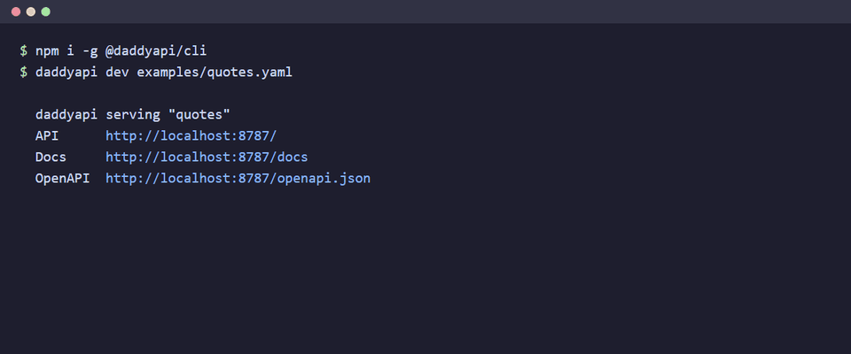

# daddyapi

[](https://github.com/abduladnan-mt7/daddyapi/actions/workflows/ci.yml)
[](https://www.npmjs.com/package/@daddyapi/cli)
[](./LICENSE)
[](https://github.com/abduladnan-mt7/daddyapi/issues?q=is%3Aissue+is%3Aopen+label%3A%22good+first+issue%22)
[](./CONTRIBUTING.md)

**Point it at a bot-friendly website. Get a documented API.**



daddyapi turns a website into a clean, cached, documented API — described by one
declarative **SiteSpec** file. From that single file you get **both** a callable
data SDK **and** a live HTTP API with auto-generated OpenAPI/Swagger docs. Stop
re-writing scrapers; capture the messy extraction once, behind a stable contract.

```bash
# Crawl a site and write a draft spec
daddyapi init https://quotes.toscrape.com --out quotes.yaml

# Serve it as a live API with Swagger docs
daddyapi dev quotes.yaml
#   API      http://localhost:8787/
#   Docs     http://localhost:8787/docs
```

> [!IMPORTANT]
> **daddyapi is for websites that welcome bots** — public sandboxes, open data,
> and sites whose `robots.txt` permits crawling. It respects `robots.txt`,
> rate-limits, caches, and identifies itself by default. It is **not** a tool for
> defeating anti-bot measures, solving captchas, or scraping behind logins.
> Please scrape responsibly and within each site's terms.

## Why

Scraping live every time is repetitive and brittle: rewritten parsing per
project, no caching, no docs, no stable interface. daddyapi flips it: write (or
auto-generate) a spec once, then call a stable API that handles polite fetching,
caching, normalization, and documentation for you.

## Install

```bash
# Requires Node.js >= 20
npm i -g @daddyapi/cli
daddyapi help
```

Or run it without installing: `npx @daddyapi/cli help`. To use the engine from
code, install [`@daddyapi/core`](https://www.npmjs.com/package/@daddyapi/core)
(see [Use it as a library](#use-it-as-a-library)).

From source, for development:

```bash
git clone https://github.com/abduladnan-mt7/daddyapi.git
cd daddyapi
pnpm install
pnpm build
node packages/cli/dist/index.js help
```

## Quick start

```bash
# 1. Generate a draft spec from a live site (review the selectors it guesses)
daddyapi init https://quotes.toscrape.com --out quotes.yaml

# 2. Test one resource — fetch and print JSON
daddyapi run quotes.yaml quotes --pages 1

# 3. Serve it as a live, documented API
daddyapi dev quotes.yaml --port 8787

# 4. Validate a spec, or export its OpenAPI document
daddyapi validate quotes.yaml
daddyapi build quotes.yaml --out openapi.json
```

Add `--cache [dir]` to `run`/`dev` to persist fetched pages to disk (default
`.daddyapi-cache`), so repeated runs don't re-hit the site.

See ready-made specs in [`examples/`](./examples).

## Give AI agents your site (MCP)

`daddyapi mcp` serves a spec as an [MCP](https://modelcontextprotocol.io) server.
Every resource becomes a **typed, read-only tool** that Claude, Cursor and other
agents can call, with the same validated, cached and polite extraction as the
HTTP API. No LLM sits between the agent and the page, so there are no made-up
fields.

```bash
daddyapi mcp quotes.yaml
```

**Claude Code:**

```bash
claude mcp add quotes -- npx -y @daddyapi/cli mcp /absolute/path/to/quotes.yaml
```

**Claude Desktop** (`claude_desktop_config.json`), **Cursor** (`.cursor/mcp.json`) and
other MCP clients:

```json
{
  "mcpServers": {
    "quotes": {
      "command": "npx",
      "args": ["-y", "@daddyapi/cli", "mcp", "/absolute/path/to/quotes.yaml", "--cache"]
    }
  }
}
```

What the agent gets:

- **One tool per resource** (`quotes`, `tags`, …) with a description of the fields it returns.
- **Typed inputs**: path parameters, `pages` (bounded), `limit`, `offset`, and
  `fields` as an enum of the spec's field names.
- **Typed output**: an output schema derived from your fields, returned as structured
  content (`{ data, warnings, meta }`) plus JSON text.
- **Clear tool errors** for bad arguments, `robots.txt` blocks and site failures, never crashes.
- The OpenAPI document as an MCP resource.

Use `--prefix name` to namespace tools when you run several specs side by side.

## A real API, not just a scraper

`daddyapi dev` behaves the way API clients expect:

| | |
| --- | --- |
| **Status codes** | `400` for a missing or invalid parameter (it names the parameter), `401` without a valid key, `403` when `robots.txt` disallows the page, `404` for unknown routes, `429` when rate-limited, `502`/`504` when the site fails or times out. Errors are always JSON: `{ "error": { "code", "message", "param" }, "requestId" }`. |
| **Shaping results** | `?limit=`, `?offset=`, `?fields=a,b`, and `?pages=` (capped by `--max-pages`, default 20). `meta` reports `total` and `returned`. |
| **Formats** | `?format=json` (default), `csv` (RFC 4180, spreadsheet-formula safe) or `ndjson`. |
| **Caching** | Content-hash `ETag`s with real `304 Not Modified`, and `Cache-Control` from the spec's `cacheTtl`. |
| **Browser access** | CORS on by default (`*`); `--cors https://app.example` to restrict, `--cors off` to disable. |
| **Auth** | `--api-key k1,k2` or `DADDYAPI_API_KEYS`; clients send `Authorization: Bearer <key>` or `X-API-Key`. Docs and `/health` stay public. |
| **Rate limiting** | `--rate-limit 60/min` per client, with `RateLimit-*` and `Retry-After` headers. |
| **Operations** | `/health`, `X-Request-Id` on every response, `--host` to choose the interface. |

All of it is described in the generated OpenAPI document, so Swagger, Postman and
codegen tools see the real contract.

```bash
daddyapi dev quotes.yaml --api-key "$MY_KEY" --rate-limit 60/min --cors https://my.app
curl -H "X-API-Key: $MY_KEY" "http://localhost:8787/quotes?limit=5&fields=author,text"
curl -H "X-API-Key: $MY_KEY" "http://localhost:8787/quotes?format=csv" > quotes.csv
```

## Know when a site changes (`daddyapi check`)

Scrapers usually break silently: the site renames a CSS class, and you keep getting
empty fields until someone notices. `daddyapi check` runs every resource and checks
the output against a **data contract**:

- Lists must return rows, required fields (not marked `optional`) must actually be
  filled, and values must have the type the spec promises.
- An optional `expect` block tightens it per resource.
- A saved **baseline** catches drift: rows dropping by half, a field's fill rate
  collapsing, or a field changing type.

```yaml
resources:
  - name: quotes
    # ...
    expect:
      minRows: 10
      fields:
        author: { fillRate: 1 }
        text: { pattern: "^“" }
  - name: author
    fetch: { path: "/author/{slug}/" }
    # ...
    expect:
      params: { slug: albert-einstein }   # example values so check can run it
```

```bash
daddyapi check quotes.yaml --update-baseline   # first run: save quotes.baseline.json
daddyapi check quotes.yaml                     # later: compare against it
```

```text
daddyapi check: quotes

  FAIL   quotes (10 rows)
           ✗ author: never found; its selector may no longer match
           ✗ author: fill rate fell from 100% to 0%
  PASS   tags (10 rows)
```

It exits `0` when healthy, `1` on a contract or drift failure and `2` when the site
can't be reached, and `--json` gives a machine-readable report. That makes it easy
to run on a schedule, for example in GitHub Actions:

```yaml
on:
  schedule: [{ cron: '0 6 * * *' }]
jobs:
  check:
    runs-on: ubuntu-latest
    steps:
      - uses: actions/checkout@v4
      - run: npx -y @daddyapi/cli check specs/quotes.yaml
```

## Get told when the data changes (`daddyapi watch`)

Page-change monitors tell you *that a page changed*. Because daddyapi already turns
the page into rows, `watch` tells you **which rows changed and how**:

```bash
daddyapi watch books.yaml books --key title --every 1h
```

```text
books: 1 added, 0 removed, 1 changed
  + added    Tipping the Velvet
  ~ changed  A Light in the Attic  (price: 51.77 → 45.00)
```

- `--key` names the field(s) that identify a row (a URL or title); without it, any
  edit shows up as one removal plus one addition.
- `--webhook https://…` POSTs each change event as JSON. Add `--webhook-secret`
  (or `DADDYAPI_WEBHOOK_SECRET`) to sign it GitHub-style:
  `X-Daddyapi-Signature: sha256=<HMAC of the body>`.
- If a webhook delivery fails, the changes are kept and sent again on the next run.
- `--once` runs a single comparison and exits, for cron; `--json` prints one
  event per line. State is saved next to the spec (`<spec>.<resource>.watch.json`).
- The interval can't go below 30 seconds, to stay polite to the site.

## Typed client and exports

```bash
daddyapi types quotes.yaml --out quotes-client.ts     # interfaces + a typed client
daddyapi types quotes.yaml --json-schema              # JSON Schema for every resource
daddyapi run quotes.yaml quotes --format csv --out quotes.csv
```

The generated TypeScript has no dependencies and talks to the API that
`daddyapi dev` serves:

```ts
import { QuotesClient } from './quotes-client';

const api = new QuotesClient('http://localhost:8787', { apiKey: process.env.KEY });
const { data, meta } = await api.quotes({ limit: 5, fields: ['author', 'text'] });
//      ^? QuotesRow[]
```

## The SiteSpec

One declarative file describes a site → API:

```yaml
name: quotes
baseUrl: https://quotes.toscrape.com
description: Quotes sandbox built for scraping practice.

resources:
  - name: quotes                 # → GET /quotes  and  client.quotes()
    fetch:
      path: /
      pagination:
        type: link
        selector: li.next a      # follow the "next" link
        maxPages: 3
    list:
      selector: .quote           # the repeating row
      fields:
        text: span.text          # shorthand: a selector → trimmed text
        author: small.author
        tags:
          selector: .tags a.tag
          many: true             # collect every match into an array
```

**Politeness** is configurable per spec and on by default:

```yaml
politeness:
  requestsPerSecond: 1
  respectRobotsTxt: true
  cacheTtl: 10m
  userAgent: "daddyapi-bot (+https://github.com/abduladnan-mt7/daddyapi)"
```

**Fields** support: `selector`, `attr` (pull an attribute), `html`, `many`
(array), `transform` (`trim`, `int`, `float`, `number`, `boolean`, `url`,
`lower`, `upper`, `date`), `default`, and `optional`.

`date` parses a free-text or ISO date into an ISO 8601 value (`2026-06-14`,
or a full timestamp for a date-time) and yields `null` when it can't parse.

A resource defines either a **`list`** (a repeating-row selector + per-row
fields) or an **`item`** (page-level fields). Missing required fields don't fail
the request — you get partial `data` plus a `warnings[]` array.

## Code escape-hatch (hooks)

The declarative spec covers most sites. For the hard 20% — values that need real
code — a spec can point at a **hooks** module and use its functions as custom
`transform`s (per field) or `postProcess`ors (per resource):

```yaml
# books-rated.yaml
hooks: ./hooks/books.mjs        # path relative to the spec file
resources:
  - name: books
    postProcess: sortByPrice    # a function from the hooks module
    fetch: { path: / }
    list:
      selector: article.product_pod
      fields:
        price:  { selector: .price_color, transform: [float] }
        rating: { selector: .star-rating, attr: class, transform: rating } # custom
```

```js
// hooks/books.mjs
const WORDS = { one: 1, two: 2, three: 3, four: 4, five: 5 };
export const transforms = {
  rating: (value) => WORDS[String(value).replace(/star-rating/i, '').trim().toLowerCase()] ?? null,
};
export const postProcess = {
  sortByPrice: (rows) => [...rows].sort((a, b) => a.price - b.price),
};
```

See [`examples/books-rated.yaml`](./examples/books-rated.yaml) for the full,
runnable version. Hooks are plain JS modules (`.mjs`/`.js`); since you reference
them in your own spec, they run with your trust — only point `hooks` at code you
control.

## Use it as a library

```ts
import { loadSiteSpec } from '@daddyapi/spec';
import { createClient, createServer } from '@daddyapi/core';

const spec = loadSiteSpec('quotes.yaml');

// Data SDK
const client = createClient(spec);
const { data, warnings, meta } = await client.quotes({ maxPages: 2 });

// Or mount it as an HTTP API (Hono app — deploy anywhere)
const app = createServer(spec, { apiKeys: ['secret'], rateLimit: { limit: 60 } });
// app.fetch(request) → Response   |   serve with @hono/node-server, Vercel, etc.

// Check it against its data contract
import { checkSpec, formatReport } from '@daddyapi/core';
console.log(formatReport(await checkSpec(spec)));

// Or hand it to an AI agent over MCP
import { createMcpServer } from '@daddyapi/mcp';
const mcp = createMcpServer(spec); // connect it to any MCP transport
```

## Packages

| Package | What it is |
| --- | --- |
| [`@daddyapi/spec`](./packages/spec) | The SiteSpec schema, loader & validator — the language-neutral contract. |
| [`@daddyapi/core`](./packages/core) | Polite fetching, extraction, the data SDK, the HTTP server, and the crawler. |
| [`@daddyapi/mcp`](./packages/mcp) | Serve a spec as an MCP server: one typed tool per resource. |
| [`@daddyapi/cli`](./packages/cli) | The `daddyapi` command: `init`, `dev`, `mcp`, `run`, `check`, `watch`, `types`, `validate`, `build`. |

## Roadmap

- [x] **Code escape-hatches** (hooks) for the hard 20% of sites
- [x] **MCP server**: typed tools for AI agents
- [x] **Data contracts and drift detection** (`daddyapi check`)
- [x] API keys, rate limits, CORS, ETags and CSV/NDJSON on served APIs
- [x] Typed client generation (`daddyapi types`)
- [x] Row-level change events and signed webhooks (`daddyapi watch`)
- [ ] **Python runtime** reading the same SiteSpec files
- [ ] JS-rendered pages (optional Playwright adapter)
- [ ] Redis cache backend
- [ ] Community **spec registry**
- [ ] One-click deploy templates

## Contributing

Contributions are welcome, and you don't need to know the whole codebase to help.

- **New here?** Pick an issue labelled
  [`good first issue`](https://github.com/abduladnan-mt7/daddyapi/issues?q=is%3Aissue+is%3Aopen+label%3A%22good+first+issue%22).
  Comment on it so nobody else starts the same work.
- **Easiest first PR:** add an example spec for a bot-friendly site
  ([how](./CONTRIBUTING.md#adding-an-example-spec)).
- **Found a bug or have an idea?** [Open an issue](https://github.com/abduladnan-mt7/daddyapi/issues/new/choose).

Setup, project layout and the PR checklist are in [CONTRIBUTING.md](./CONTRIBUTING.md).
Please follow the [Code of Conduct](./CODE_OF_CONDUCT.md). The design doc lives in
[`docs/superpowers/specs`](./docs/superpowers/specs).

## License

[MIT](./LICENSE) © 2026 Abdul Adnan
